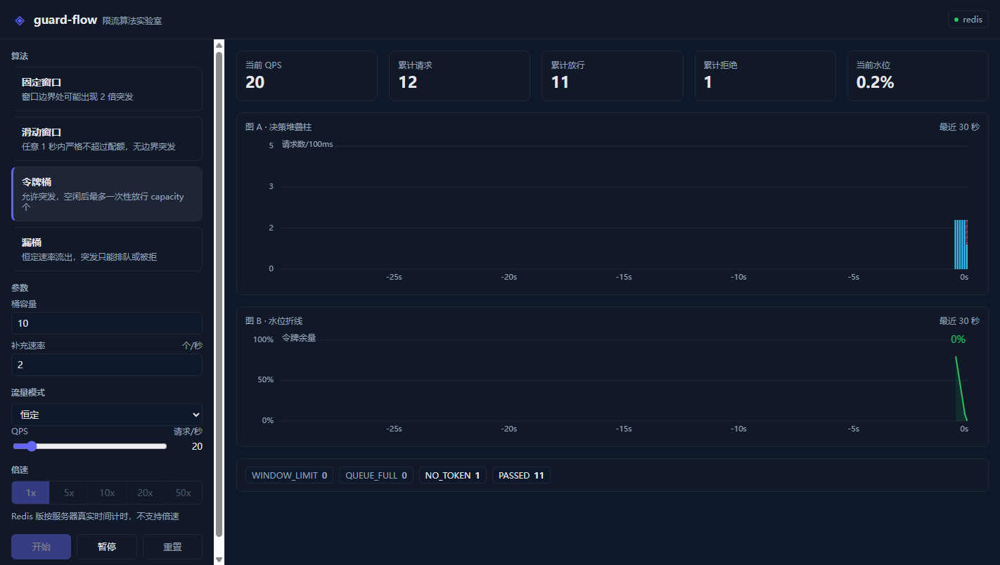
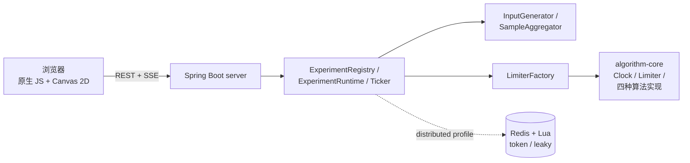

# guard-flow · 限流算法可视化实验室

用可调参数和可加速的虚拟时钟，把固定窗口、滑动窗口、令牌桶、漏桶四种限流策略的实时决策画成图表——让四种算法的差异与缺陷在 30 秒内可见。



> 当前图片是截图占位；README 的 GIF 分镜脚本见 [`docs/README.md`](docs/README.md) 附录，后续替换为录屏 GIF。

## 为什么做这个

- 文档和博客能解释令牌桶和漏桶的区别，但「窗口边界 2 倍突发」「空闲后令牌桶允许突发、漏桶只能排队」这类现象，看图比读定义快。
- 单机算法通常依赖真实时间，等待滑动窗口过期要好几秒；这里用虚拟时钟和倍速，把 30 秒逻辑时间压缩到 1 秒内。
- 四种算法共用一套 `Limiter`、`Decision`、`Snapshot` 契约，方便对照，也方便用同一套 SSE 指标观察。

## 快速开始

要求：JDK 21、Maven 3.9+。

```bash
# 1. 构建可执行 jar
mvn -q clean package -DskipTests

# 2. 启动服务（默认 local profile）
java -jar server/target/guard-flow-server-1.0.0-SNAPSHOT.jar

# 3. 打开浏览器
# http://localhost:8080
```

开发时跑全量测试：

```bash
mvn -q clean verify
```

### 分布式模式（可选）

```bash
docker compose up -d redis
java -jar server/target/guard-flow-server-1.0.0-SNAPSHOT.jar --spring.profiles.active=distributed
```

`token_bucket` 与 `leaky_bucket` 走 Redis + Lua；窗口类算法仍为本地实现。Redis 不可用时自动降级为 `local` 并记录 WARN，不影响创建实验。

## 四种算法

| id | 算法 | 关键行为 | 已知现象 / 取舍 | 后端 |
|---|---|---|---|---|
| `fixed_window` | 固定窗口 | 窗口内计数，进入新窗口清零 | 边界处可能出现 **2×limit** 突发（刻意保留的演示缺陷） | local |
| `sliding_window` | 滑动窗口（日志法） | 保留最近 `windowMillis` 的放行时间戳 | 任意窗口严格不超过 `limit`，内存 `O(limit)` | local |
| `token_bucket` | 令牌桶 | 容量 `capacity`，按 `ratePerSecond` 惰性补充 | 允许突发；小数令牌累积，不足 1 个即拒绝 | local / redis |
| `leaky_bucket` | 漏桶 | 队列容量 + 固定速率出队，满即拒绝 | 削峰填谷；不模拟真实排队等待 | local / redis |

测试向量与精确判定逻辑见 [`docs/spec-algorithms.md`](docs/spec-algorithms.md)。

## 架构



- `algorithm-core`：零第三方依赖、无 Spring import；算法只接收 `long nowMillis`，不自己读时钟。
- `server`：REST、SSE、实验编排、采样聚合；`TickerConfig` 用单线程定时任务驱动所有实验。
- 前端：`server/src/main/resources/static/` 下的原生 HTML/CSS/ES Module + Canvas，无前端库、无构建。

目录与类职责见 [`docs/file-manifest.md`](docs/file-manifest.md)，接口契约见 [`docs/api.md`](docs/api.md)。

## 指标口径

每个逻辑 100ms 产生一条 `Sample`：

| 字段 | 含义 |
|---|---|
| `t` | 该帧结束时的逻辑时间（ms） |
| `offered` | 本帧到达请求数 |
| `passed` / `rejected` | 放行 / 拒绝数，恒有 `passed + rejected == offered` |
| `level` | 归一化水位 `[0,1]`；算法不同含义不同 |
| `reason` | 本帧主要拒绝原因；无拒绝时为 `PASSED` |

页面当前 QPS = `offered / 0.1`，不做平滑。完整字段与 SSE 事件见 [`docs/api.md`](docs/api.md)。

## 分布式模式的时间语义：为什么锁 1x

Redis 版限流器在 Lua 内用 `redis.call('TIME')` 取 Redis 服务器墙钟，不读取应用传入的逻辑时间。于是倍速只提高 tick 密度，并不会改变 Redis 的令牌补充或漏桶出队基准；同一组参数下，单机结果与分布式结果不能直接比较。`Sample.t` 仍然是逻辑时间，而 `level` 读的是 Redis 里的真实状态，只有 `speed=1` 时两者才近似同一基准。因此分布式 profile 强制 `speed=1`：请求其他倍速时创建响应返回 `speed:1` 与 `speedAdjusted:true`，前端倍速控件整体置灰并提示「Redis 版按服务器真实时间计时，不支持倍速」。我们也不把逻辑时间传给 Lua：多实例部署时各实例虚拟时钟不同步，会破坏分布式语义；更不采用「倍速下放大 Redis 速率」的做法，否则页面参数与真实生效速率不一致。reset 会删除该实验的 `guardflow:rl:*` 键，避免旧令牌/旧队列让页面看似归零失败。

## 测试

```bash
# 全量
mvn -q clean verify

# 核心算法
mvn -pl algorithm-core test

# Redis 集成测试（需要容器环境）
mvn -q -pl server test -Dtest=RedisLimiterIT
```

`RedisLimiterIT` 使用 `@Testcontainers(disabledWithoutDocker = true)`；无 Docker 环境会 skip 而不是 fail。

## Roadmap

- 滑动窗口计数器近似法（Sliding Window Counter）
- 预热 / 冷启动（Warm-up）模式
- 分布式令牌桶的集群 / 哨兵支持（当前只做单 Redis）
- 横向对比 benchmark（不同算法在同一输入下的通过率 / 延迟）
- README 的 GIF 录屏替换静态占位图

## 文档索引

- [AGENTS.md](AGENTS.md)：工程约定、命令、禁区、DoD
- [docs/README.md](docs/README.md)：规格文档索引
- [docs/spec-algorithms.md](docs/spec-algorithms.md)：算法定义与测试向量
- [docs/api.md](docs/api.md)：HTTP / SSE 契约
- [docs/ui-spec.md](docs/ui-spec.md)：布局、配色、图表规格
- [docs/dependencies.md](docs/dependencies.md)：依赖白名单
- [docs/tasks.md](docs/tasks.md)：T0~T12 任务卡
- [CHANGELOG.md](CHANGELOG.md)：版本变更

## 说明

这是一个教学 / 演示型工程，不是生产级 API 网关：没有鉴权、没有持久化、没有集群治理，限流器也刻意保留了固定窗口的 2 倍突发缺陷用于演示。

## License

[MIT](LICENSE)
